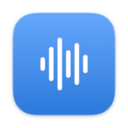
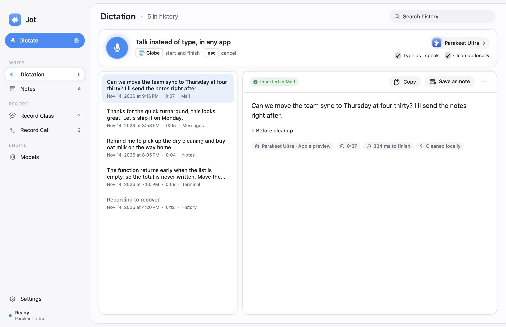
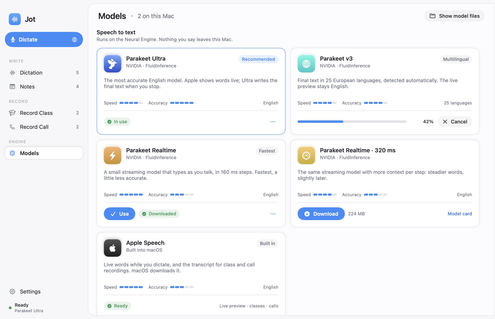
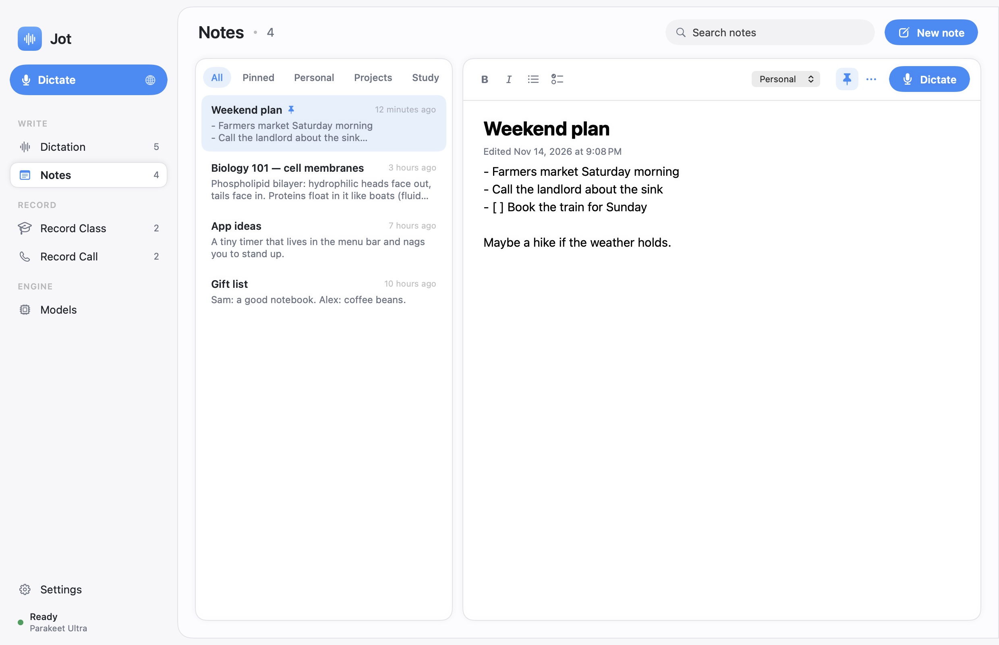
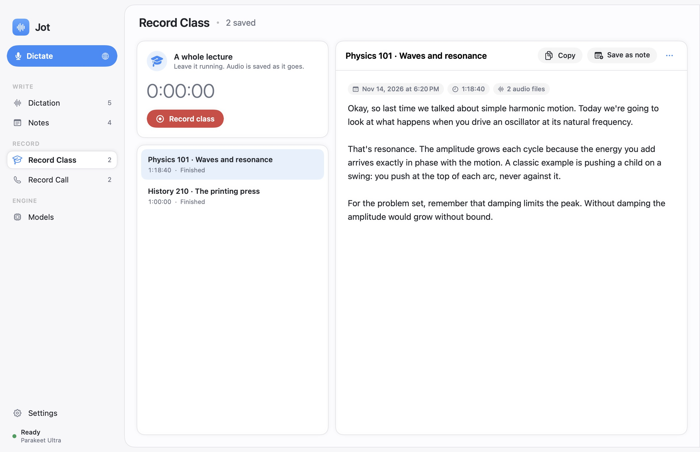
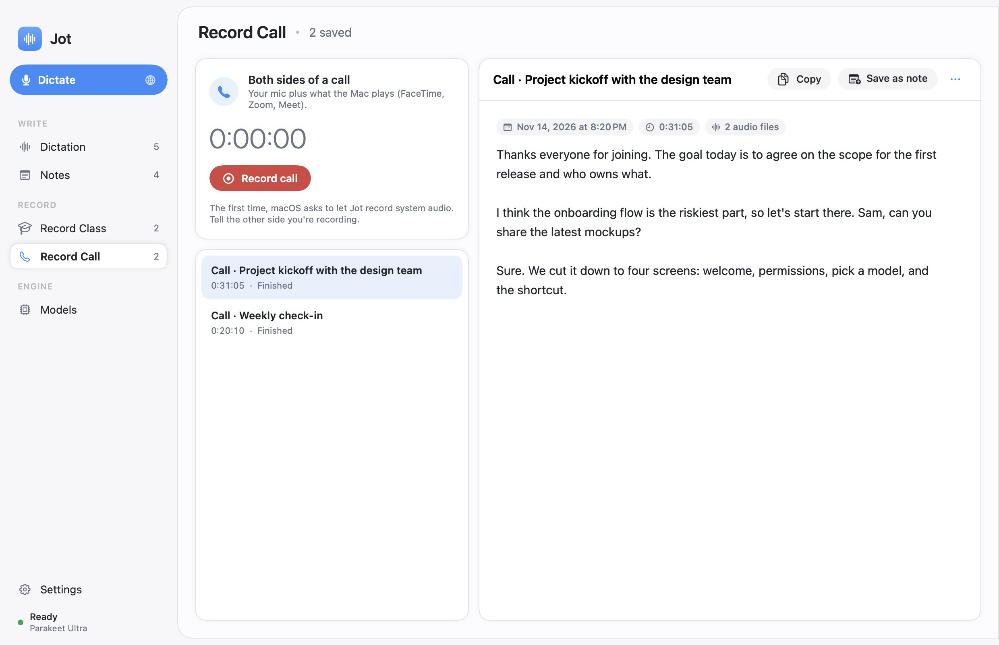

<div align="center">



# Jot

Talk instead of type, on your Mac. Tap the Globe key (or a shortcut you choose), speak, tap again,<br>
and the words land where your cursor is. Notes, class recordings and call recordings in the same app.

[](https://newitools.app/jot/)
[](https://github.com/andrewneuwirth/jot/releases/latest)
[](https://github.com/andrewneuwirth/jot/actions/workflows/ci.yml)
[](Package.swift)
[](LICENSE)

[**Download**](https://github.com/andrewneuwirth/jot/releases/latest) · [Website](https://newitools.app/jot/) · [Privacy](PRIVACY.md)

<br>

<picture>
  <source media="(prefers-color-scheme: dark)" srcset="docs/dictation-dark.jpg">
  
</picture>

</div>

Every speech model runs on your Mac: no account, no server, no cloud transcription. SwiftUI and AppKit, macOS 26, Apple
Silicon.

## Features

| Dictate into any app | Models you choose | Cleanup |
| --- | --- | --- |
| Tap Globe (fn) to start and finish, Esc to cancel, or pick a key combination or a lone Right ⌘ / Right ⌥ tap. Words appear live where the app allows it; otherwise Jot pastes when you stop. Everything is kept in History. | Parakeet Ultra (most accurate English), Parakeet v3 (25 European languages) and Parakeet Realtime, with Apple's on-device speech for live words. Download, switch and delete them on the Models page. | Fillers and spoken corrections removed ("Tuesday, I mean Wednesday" becomes "Wednesday") by a built-in Qwen3 4B model run by llama.cpp, about 0.12-0.2 s per sentence once loaded. Optional; or use your own cloud API key. |
| **Notes** | **Record Class** | **Record Call** |
| Folders, pins, search and Markdown shortcuts. Dictate straight into a note, or save any dictation or recording as one. | Hours of audio saved to disk as it goes, with a live transcript and re-transcription later with your chosen model. | Your microphone plus what the Mac plays, so both sides of a FaceTime, Zoom or Meet call are in one transcript. |

Also: hold Space to talk in chosen apps, spelling rules, a floating bubble, Open at Login and a first-launch walkthrough.
Cleanup keeps the original in History and quotes verbatim. Record Call shows no consent notice by design; telling the
other side you're recording is up to you.

## Screenshots

<table>
<tr>
<td width="50%"><picture><source media="(prefers-color-scheme: dark)" srcset="docs/models-dark.jpg"></picture><br><sub>Models: download, use or delete</sub></td>
<td width="50%"><picture><source media="(prefers-color-scheme: dark)" srcset="docs/notes-dark.jpg"></picture><br><sub>Notes</sub></td>
</tr>
<tr>
<td width="50%"><picture><source media="(prefers-color-scheme: dark)" srcset="docs/classes-dark.jpg"></picture><br><sub>Record Class</sub></td>
<td width="50%"><picture><source media="(prefers-color-scheme: dark)" srcset="docs/calls-dark.jpg"></picture><br><sub>Record Call</sub></td>
</tr>
</table>

Screenshots use made-up data (`Jot --ui-preview DIR` renders every page that way).

## Install

Download `Jot-0.1.0.dmg` from [Releases](https://github.com/andrewneuwirth/jot/releases/latest), open it and drag Jot to
Applications. It's signed with Developer ID and notarized by Apple, updates itself, and needs macOS 26 on an Apple Silicon
Mac. On first launch the walkthrough asks you to pick and download a speech model; the cleanup model (2.5 GB) is optional,
and a cloud API key works instead.

### Build from source

Needs Xcode 26 or later (Swift 6.2 tools) on macOS 26 and an Apple Silicon Mac.

```sh
git clone https://github.com/andrewneuwirth/jot.git Jot && cd Jot
swift build && .build/debug/Jot --self-check   # should end with "self-check ok"
swift test                                      # unit tests
./build.sh                                      # makes build/Jot.app
open build/Jot.app
```

Jot uses MacToolsKit from [mac-tools-kit](https://github.com/andrewneuwirth/mac-tools-kit) (SwiftPM fetches it, or uses
a checkout at `../Kit`) and [FluidAudio](https://github.com/FluidInference/FluidAudio) for Parakeet on Core ML, pinned in
`Package.swift`. `build.sh` signs with your Apple Development identity if you have one (a stable signature keeps the
Microphone and Accessibility grants across rebuilds), otherwise ad hoc. To use your own bundle id or signing identity, copy
`config.example.env` to `config.local.env` and edit it.

## Permissions

- **Microphone**: required, to hear you.
- **Accessibility**: for the dictation shortcut and typing into other apps.
- **System audio recording**: only for Record Call; macOS asks the first time.

If tapping Globe opens the emoji picker or Apple's dictation, set System Settings › Keyboard › "Press 🌐 key to" to
**Do Nothing**.

## For other tools

- `Jot --transcribe <file>` prints a raw Parakeet Ultra transcript of an audio file (wav, m4a, mp3, flac, caf, ogg,
  WebM/Opus) and exits; it never downloads and never opens a window.
- `jot://toggle` starts or finishes a dictation. It asks for no confirmation, by design: it can only start or finish a
  dictation, which shows the bubble and goes into History like any other.
- While Jot records it posts the distributed notification `app.newitools.jot.recording` with `userInfo["active"]`
  (a Bool), so a wake-word listener can pause.
- `Jot --prepare-model`, `Jot --benchmark <file> [--reference "<text>"]` for local measurements.

## Privacy

Audio never leaves your Mac. The network requests are model downloads from Hugging Face, macOS fetching its own speech
assets, a daily update check, and, only if you set up cloud cleanup with your own key, the finished transcript text sent
to that provider. Full policy: [PRIVACY.md](PRIVACY.md).

## Contributing

See [CONTRIBUTING.md](CONTRIBUTING.md) and [AGENTS.md](AGENTS.md). Security issues: [SECURITY.md](SECURITY.md).

## License

[MIT](LICENSE). Jot is part of [newi tools](https://newitools.app/jot/). FluidAudio is Apache-2.0. The Parakeet models (NVIDIA, converted to Core ML by FluidInference) keep their
own licenses, linked from each model card. Model weights are downloaded, never checked in. `Tests/Fixtures/jfk.wav` is a
public-domain excerpt of a 1961 inaugural address, from the [whisper.cpp](https://github.com/ggml-org/whisper.cpp)
samples, used as a short smoke test.
